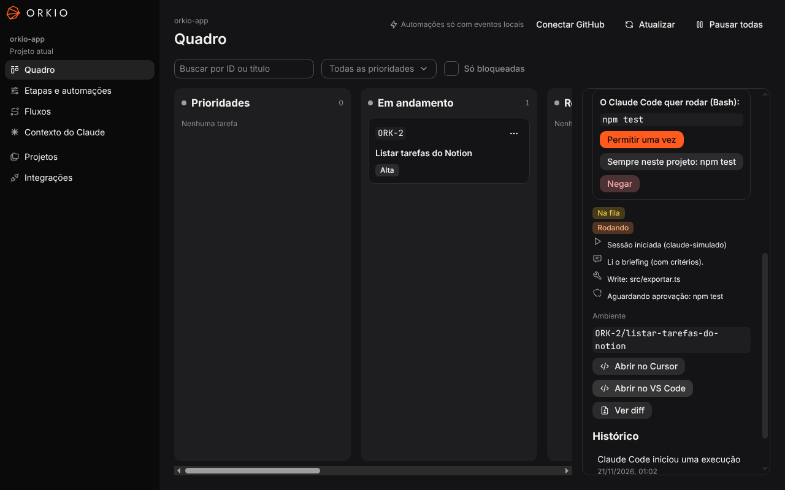
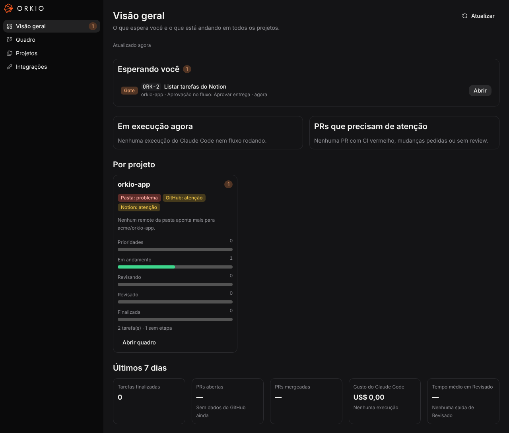
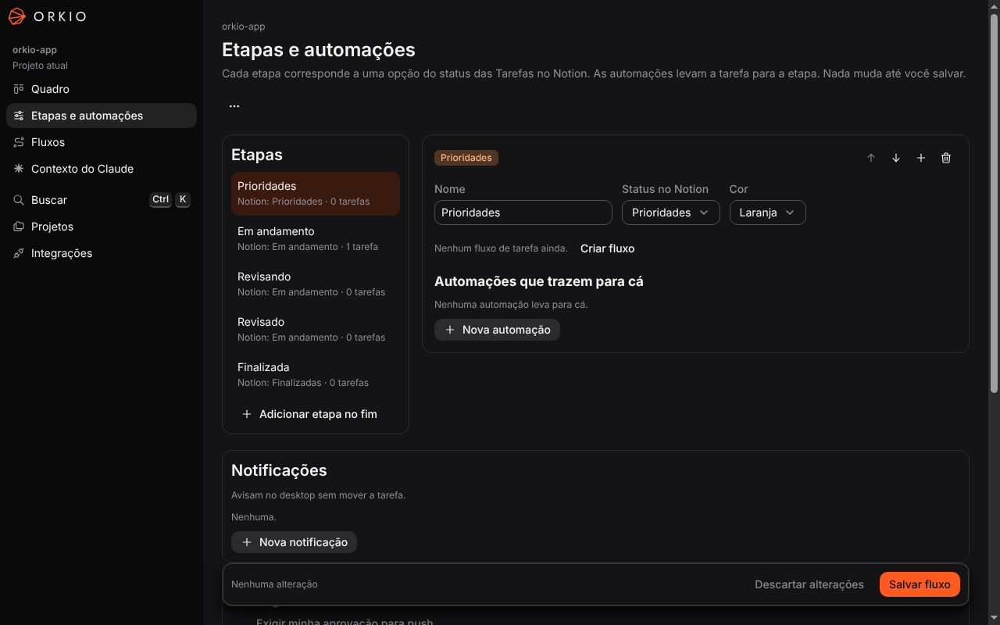
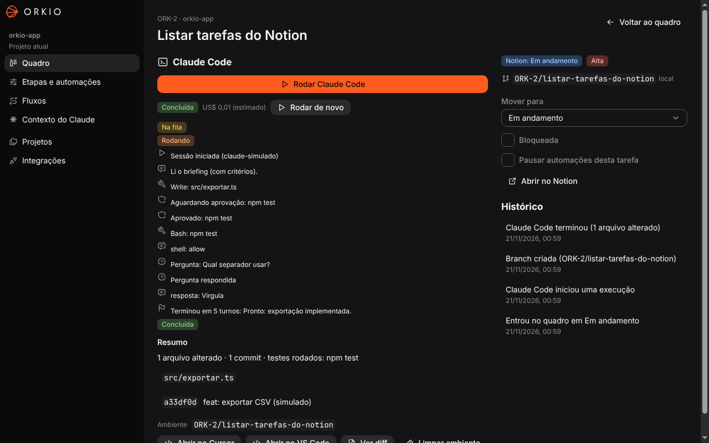
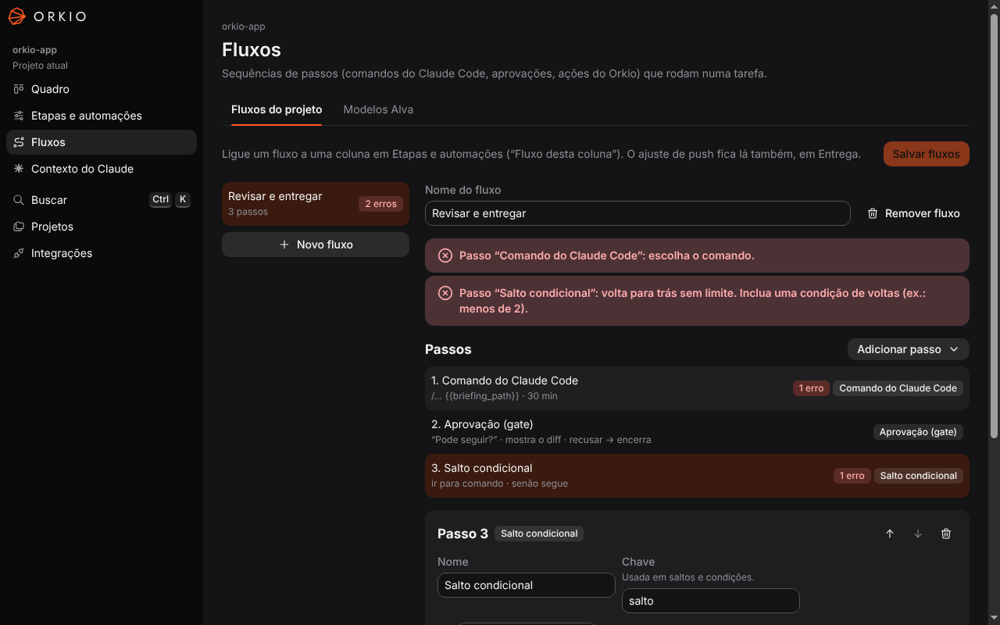
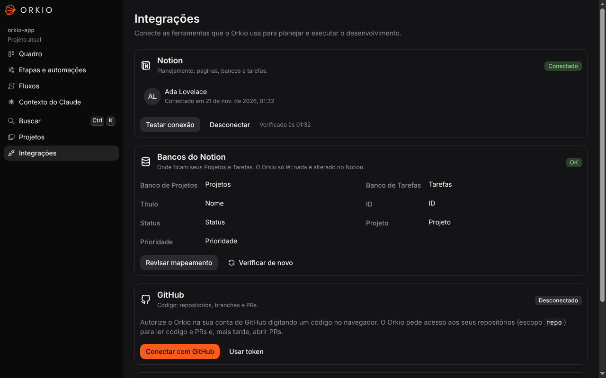
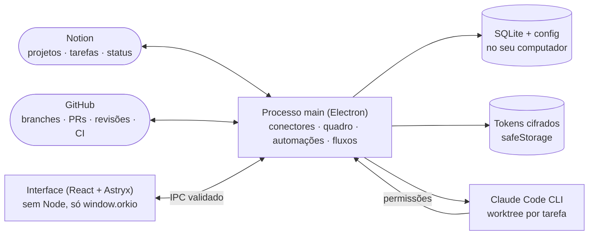

<div align="center">
  <picture>
    <source media="(prefers-color-scheme: light)" srcset="docs/readme/lockup-light.png">
    
  </picture>
  <p><sub>DO CONTEXTO AO COMMIT</sub></p>
  <h1>Suas tarefas do Notion viram PRs revisadas. Com você no controle.</h1>
  <p>
    O Orkio orquestra Notion, GitHub e Claude Code num app de desktop.<br>
    Monta o quadro, roda o agente num ambiente isolado por tarefa e move cada card conforme a PR avança.
  </p>
  <p>
    <a href="https://github.com/uBrunoow/orkio-releases/releases/latest"><strong>Download</strong></a> ·
    <a href="#primeiros-passos"><strong>Primeiros passos</strong></a> ·
    <a href="docs/configuracao.md"><strong>Configuração</strong></a> ·
    <a href="docs/desenvolvimento.md"><strong>Desenvolvimento</strong></a> ·
    <a href="brand/BRAND.md"><strong>Marca</strong></a>
  </p>
  <p>
    <a href="https://github.com/uBrunoow/orkio-releases/releases/latest">
      
    </a>
    
    
    
    
    <br>
    
    
    
    
  </p>
</div>

<p align="center">
  
</p>

O gargalo deixou de ser o modelo. Virou o caminho entre as ferramentas. A tarefa está no Notion, o
código no GitHub e o agente num terminal, e quem cola tudo é você: copia o contexto da página, cria
a branch, acompanha o Claude Code, abre a PR e volta ao Notion para mudar o status.

O Orkio faz esse caminho num lugar só. Ele lê as tarefas do Notion, monta um kanban por projeto,
roda o Claude Code com o seu login num worktree isolado para cada tarefa e acompanha branch, PR,
revisão e CI no GitHub. Nada vai para a main sem você: o push é só da branch da tarefa, e os
pontos que importam esperam a sua aprovação.

## Instalar

Baixe o instalador do [último release](https://github.com/uBrunoow/orkio-releases/releases/latest).

- **macOS** (`Orkio-…-mac-arm64.dmg` para Apple Silicon, `…-mac-x64.dmg` para Intel): arraste para
  Aplicativos. Enquanto o app não tiver assinatura da Apple, a primeira abertura é bloqueada: abra
  uma vez e depois vá em **Ajustes do Sistema → Privacidade e Segurança → Abrir Mesmo Assim**.
- **Windows** (`Orkio-…-win-x64-setup.exe`): instala no seu usuário, sem pedir administrador.
  Sem assinatura, o SmartScreen avisa: **Mais informações → Executar assim mesmo**.

<details>
<summary>Rodar a partir do código</summary>

```bash
git clone https://github.com/uBrunoow/orkio.git
cd orkio
pnpm install   # também baixa o binário do Electron
pnpm dev       # abre o app com hot reload
```

Precisa de Node.js 22.12+ (ou 20.19+), pnpm 10+ e `git` no PATH. No Linux, um keyring ativo
(GNOME Keyring ou KWallet): sem ele o Orkio não salva tokens. Detalhes em
[docs/desenvolvimento.md](docs/desenvolvimento.md).

</details>

Para rodar tarefas com IA, instale o [Claude Code](https://docs.claude.com/en/docs/claude-code)
e entre com a sua conta (`claude` no terminal). O Orkio usa esse login e não pede chave de API.

## Primeiros passos

1. **Integrações → Conectar com Notion.** Escolha o workspace e as páginas dos seus bancos.
2. **Integrações → Conectar com GitHub.** Copie o código, cole em github.com/login/device e autorize.
3. **Bancos do Notion.** Escolha o banco de Projetos e o de Tarefas e confirme o mapeamento
   (título, status, ID como `ORK-142` e a relação com o projeto).
4. **Projetos → Adicionar projeto.** Aponte a pasta do clone; o Orkio acha o repositório no GitHub.
   Vincule o projeto à página dele no Notion.
5. **Quadro → Criar quadro.** Confirme as etapas sugeridas e abra uma tarefa.
6. **Rodar Claude Code** no painel da tarefa. Acompanhe o log e aprove o que o agente pedir.

As apps OAuth e os tokens alternativos estão em [docs/configuracao.md](docs/configuracao.md).

## Tudo o que espera você, numa tela

<p align="center">
  
</p>

A Visão geral junta todos os projetos: gates e perguntas esperando a sua resposta, execuções do
Claude Code em andamento, PRs com CI vermelho ou alterações pedidas, o quadro de cada projeto em
barras e a atividade recente. Esperando você é a única coisa que chama atenção.

## Um quadro ligado ao Notion

<p align="center">
  
</p>

Cada projeto tem um kanban com as suas etapas, e cada etapa corresponde a uma opção do status das
Tarefas no Notion. Mover um card escreve no Notion só quando o status muda.

- **Sem internet**, a mudança fica pendente e é enviada sozinha depois, mesmo se você fechar o app.
- **Branch e PR no card**, casadas pelo ID da tarefa (`ORK-142/sync-notion`, ou "ORK-142" no título).
- **Bloqueada** e **pausar automações** por tarefa, com histórico do que aconteceu e por quê.
- **O Notion continua a fonte da verdade.** O conteúdo das páginas nunca é gravado em disco.

## O Claude Code trabalha num ambiente só da tarefa

<p align="center">
  
</p>

O Orkio roda o CLI `claude` com o seu login, num worktree próprio da tarefa, com um briefing
montado da página do Notion. A sua pasta principal nunca é tocada.

- **Permissões pelo Orkio.** Comandos de shell perguntam (uma vez, sempre neste projeto ou negar).
  Push, `gh pr` e arquivos fora do worktree são bloqueados sem perguntar.
- **Log ao vivo e redigido.** Segredos e valores do `.env` somem do log antes de gravar.
- **Resumo ao terminar:** arquivos, commits, testes rodados e custo estimado, com
  "Abrir no Cursor", "Abrir no VS Code" e "Ver diff".
- **Catálogo de comandos** do usuário, do projeto e dos plugins, "Rodar de novo" e contexto do
  projeto (instruções e páginas do Notion) no briefing.

## Fluxos que param quando é a sua vez

<p align="center">
  
</p>

Um fluxo é uma sequência de passos ligada a uma coluna: comandos do Claude Code, gates de
aprovação, ações do Orkio e saltos condicionais. Entrou em Em andamento? Implementa, revisa,
mostra o diff e espera você.

- **Falha sempre pausa.** Reabrir o app nunca segue sozinho; "Pular" é a forma explícita de seguir.
- **Entrega com gate:** push da branch da tarefa pelo Orkio, PR aberta pelo `/pr` em modo entrega
  e pedido de review pelo conector. Merge, força e outras branches são bloqueados.
- **Modelos prontos para o alva-flow**
  (`/spec`, `/plan`, `/implement`, `/review`, `/commit`, `/pr`) com vínculo ao Backlog.md.

## O GitHub move as tarefas por você

Com o quadro criado, o Orkio acompanha o git e o GitHub em segundo plano e aplica regras simples:

| Quando                                                | Vai para                       | Se estiver em             |
| ----------------------------------------------------- | ------------------------------ | ------------------------- |
| Uma branch com o ID (ex.: `ORK-142/sync`) é criada    | Em andamento                   | Prioridades               |
| A PR é aberta ou fica pronta para review              | Revisando                      | Prioridades, Em andamento |
| A review pede alterações ou deixa comentários abertos | Revisado                       | Revisando                 |
| Você pede review de novo                              | Revisando                      | Revisado                  |
| A PR é mergeada                                       | Finalizada                     | qualquer etapa            |
| A PR é fechada sem merge                              | Em andamento (com notificação) | qualquer etapa            |

Cada evento age uma vez só, mesmo reiniciando o app. A primeira observação é só linha de base:
ligar o quadro não move nada pelo histórico antigo. Se você mover a tarefa à mão depois do evento,
vale a sua escolha. Etapas e regras se editam em **Etapas e automações**, com validação de
conflitos e ciclos, simulação, exportar/importar e histórico de alterações.

## Conecta o que você já usa

<p align="center">
  
</p>

| Integração      | Como conecta                            | Para quê                                              |
| --------------- | --------------------------------------- | ----------------------------------------------------- |
| **Notion**      | OAuth (ou token)                        | Projetos, tarefas, status, briefing e publicar docs   |
| **GitHub**      | OAuth Device Flow (ou fine-grained PAT) | Repositórios, branches, PRs, revisões, CI e reviewers |
| **Claude Code** | O CLI `claude` com o seu login          | Rodar as tarefas, comandos e plugins                  |
| **Editores**    | `cursor` e `code` no PATH               | Abrir o worktree da tarefa                            |

As suas assinaturas continuam suas. O Orkio não pede nem guarda chave da Anthropic.

## Seus tokens ficam com você

- Todas as chamadas ao Notion e ao GitHub saem do processo main. A interface não tem acesso a
  Node e nunca vê um token.
- Tokens ficam cifrados pelo sistema (Keychain, DPAPI, libsecret/KWallet), com permissão `0600`.
  Sem criptografia disponível, o Orkio não salva.
- CSP estrita em produção, navegação bloqueada e links externos só por allowlist.
- O intermediário OAuth do Notion (no site) só repassa a troca do código e não guarda nada.

Detalhes em [docs/configuracao.md](docs/configuracao.md#segurança).

## Como funciona



Um app Electron com o processo main como único lugar com rede, disco e segredos. A interface fala
com ele por uma API mínima e tipada. O estado local (etapas, histórico, execuções, fluxos) fica em
SQLite no seu computador, só com ids e metadados; o conteúdo continua no Notion e no GitHub. O
Claude Code roda como processo filho, sem shell, e cada pedido de permissão passa por uma ponte MCP
local até o Orkio.

## Documentação

| Começar                                   | Aprofundar                                   | Referência                          |
| ----------------------------------------- | -------------------------------------------- | ----------------------------------- |
| [Instalar](#instalar)                     | [Configuração](docs/configuracao.md)         | [CLAUDE.md](CLAUDE.md) (convenções) |
| [Primeiros passos](#primeiros-passos)     | [Desenvolvimento](docs/desenvolvimento.md)   | [Marca](brand/BRAND.md)             |
| [Integrações](#conecta-o-que-você-já-usa) | [Site e intermediário OAuth](site/README.md) | [Como funciona](#como-funciona)     |

## Desenvolvimento

```bash
pnpm install
pnpm dev
```

Antes de dar uma mudança por concluída:

```bash
pnpm typecheck && pnpm lint && pnpm test
pnpm e2e          # mudou UI, IPC, preload, segurança ou build? Linux headless: xvfb-run -a pnpm e2e
```

O E2E roda o app Electron real com Notion e GitHub simulados e um Claude Code falso no PATH:
nenhum token real é usado. Leia o [CLAUDE.md](CLAUDE.md) antes de editar e o
[guia de desenvolvimento](docs/desenvolvimento.md) para build, empacotamento e a interface.

## Contribuindo

O repositório é privado. Quem tem acesso abre uma branch e uma pull request; a PR está pronta quando
o CI passa e segue as regras do [CLAUDE.md](CLAUDE.md): tokens só no main, textos em pt-BR, UI com
Astryx e tokens do tema, CSP estrita. Problemas de segurança vão direto ao mantenedor, não numa issue.

## Licença

© Orkio. Todos os direitos reservados. O código não é open source.
